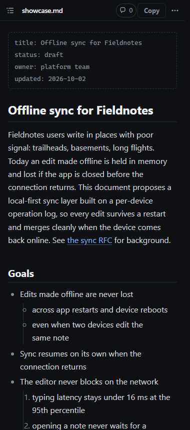
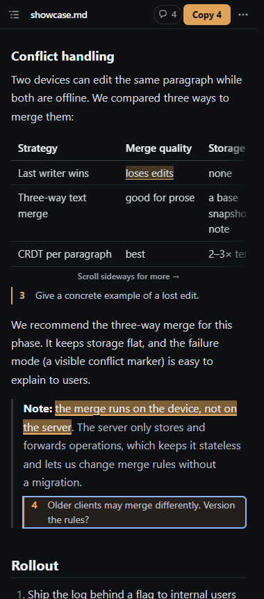
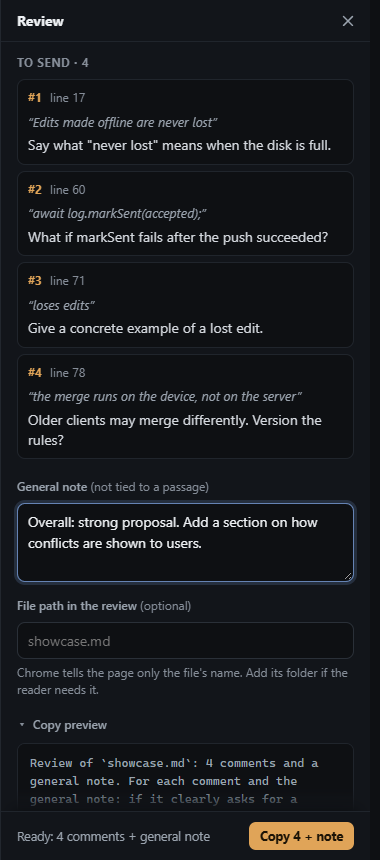

# Markdown Annotator

`markdown-annotator.html` is one self-contained web page, dark or light (it follows the system by default). You
open a Markdown file, highlight passages and comment on them. One key then copies everything as a **single
consolidated review**, with quotes and source line numbers, ready to paste wherever the feedback goes: an AI coding
assistant such as Claude Code, a chat, or a pull request. It needs no server and no install, and makes no network
requests of its own (an image a document links to still loads). Copy the file anywhere and open it in Chrome.

It is built for a narrow Chrome window next to a terminal, and is tested on Windows and macOS. The review loop is
inspired by [Ch00k/claude-review](https://github.com/Ch00k/claude-review).

**Get it:** download [`markdown-annotator.html`](markdown-annotator.html) (on GitHub, open the file and use
*Download raw file*), then open the downloaded file in Chrome. That one file is the whole tool.

| Reading at 380 px | Commenting | Review and copy preview |
|---|---|---|
|  |  |  |

More screenshots, of every surface at 380, 760 and 1280 px, are in [`docs/screenshots/`](docs/screenshots/), and in
light mode at 380 and 1280 px in the `-light` folders. The theme follows the system unless you pick Light or Dark in **⋯ → Settings**.

## Use it

1. Open `markdown-annotator.html` in Chrome.
2. Drop a `.md` file onto the page or press `Ctrl+O` / `⌘O`. You can also paste Markdown text, or click **Try it on a
   sample document**.
3. Select text and press **C** (or click the *Comment* pill). Type, then press **Enter**.
4. Press **Ctrl+Enter** / **⌘Enter** to copy the review, and paste it where it's needed.
5. When the file changes on disk (you or an agent edited it), the page reloads it in place. Changed blocks get a
   quiet green bar, and **N** jumps between them. Comments you already sent move to *Earlier rounds*, so the next
   copy has only new ones.

Press **G** for a **general note**: feedback that isn't tied to a passage, which goes at the end of the review.

### What gets copied

```
Review of `PLAN.md`: 2 comments and a general note. For each comment and the general note: if it clearly asks for a change, edit the file; if it is a question, an opinion or unclear, answer in chat without editing. Quotes are rendered text with the Markdown syntax removed, so match them loosely. Line numbers matched the file on disk when I copied this. End with one line per comment and one for the general note, saying what you did.

## Comment 1 (line 35, under "Plan: Async Deploy Pipeline > Design")
> The combination of mutex (for in-process synchronization) and database queries

Why not advisory locks here?

## Comment 2 (line 52, code block under "Design > Step 6: Add Helper Function for Status…")
> return domain.ProjectStatusFailed

Use Unknown, not Failed.

## General note
Tighten the intro; it repeats the summary.
```

The instructions at the top adapt to what you send: with only a general note they leave out everything about
comments, quotes and line numbers, and for pasted text they describe the text by its title or first words and
ask for the whole revised document when it exists only in the chat. You can replace them in **⋯ → Settings**. Chrome only tells the page the file's name, not its
folder. If the name is ambiguous, set **File path in the review** in the Review drawer (**R**).

### Keys

| Key | Action |
|---|---|
| `C` or `Enter` with text selected | Comment on it |
| `Enter`, `Shift+Enter`, `Esc` | Save, new line, cancel (with Undo) |
| `Ctrl/⌘+Enter` | Copy the review (inside a comment: save, then copy) |
| `J` / `K` | Next or previous comment (`Enter` edits it) |
| `N` / `Shift+N` | Next or previous changed block after a reload |
| `G` · `R` · `O` | General note · Review drawer · outline |
| `Ctrl/⌘+O` | Open a file |
| `?` | All shortcuts |

Two tabs on the same document stay in sync, and neither overwrites the other's comments, including a tab closed
right after a change. Without a mouse, turn on
Chrome's caret browsing (`F7`) and select with `Shift` and the arrow keys.

### Live reload and Chrome's file permission

A page can only re-read a file on disk if Chrome lets it. When you open a file with `Ctrl/⌘+O` or drop it onto the
page, Chrome gives the page a *file handle* with read permission. The page keeps the handle and re-reads the file
about once a second while the page is visible. That is how edits made in your editor or by an agent appear on
their own.

Chrome keeps that permission while the page is open, including across reloads. It drops the permission when you
quit Chrome (and after the page has been closed for a while). The next time you open the page, it shows the last
saved copy of the document, with all your comments, and a **Reconnect** button in the top bar. One click there
(Chrome may show a small prompt) restores live reload. Recent Chrome versions may offer *Allow on every visit* in
that prompt; if you pick it, the click isn't needed next time. Nothing is lost while disconnected; the page simply
isn't watching the file.

A file chosen through the fallback file dialog, or pasted text, is a snapshot: it never reloads.

On Chrome 153 and early 154 builds, a file is followed only in the tab that opened it: another tab, or a reload,
shows the saved copy with **Reconnect**, which picks the file again and carries on with the same review. Those
builds crash the whole browser when an Incognito window reads a file's permission back from storage, and a page
can't tell an Incognito window apart. Chrome 154.0.8037.95 and later don't need this (early 155 test builds,
before 155.0.8059.12, do).

Chrome 153 and 154 also crash the whole browser if a tab closes while it is storing a file's permission. The page
stores it only at the moment you open or reconnect a file (and once when it upgrades data from version 1.0.0),
never when saving or closing, so only closing the tab within a few hundredths of a second of that can still hit it.

### Privacy

Everything stays in the browser (IndexedDB and localStorage). Nothing is uploaded, and the page itself makes no
network requests, although a remote image inside a Markdown file still loads. Chrome gives every `file://` page
the same storage, so any other local HTML file you open could read it. The page keeps at most 30 documents, and
**Forget all** on the start screen clears them.

## For agents and scripts

The page can't read a file path on its own, so an agent hands it the document in the link, after `#`:

```
markdown-annotator.html#path=docs/PLAN.md&md64=<base64 of the file's UTF-8 bytes>
```

`md=<percent-encoded text>` works too (`md64` wins if both are given). `path` (or `name=PLAN.md`) is how the
review names the file; with neither, the text counts as pasted. Windows (PowerShell):

```powershell
$b = [Convert]::ToBase64String([IO.File]::ReadAllBytes("$PWD\docs\PLAN.md"))
Start-Process chrome "file:///C:/tools/markdown-annotator.html#path=docs/PLAN.md&md64=$b"
```

macOS (run Chrome's binary: `open` can drop the `#` part of a file URL; `&` keeps the shell free):

```bash
"/Applications/Google Chrome.app/Contents/MacOS/Google Chrome" "file:///Users/me/markdown-annotator.html#path=docs/PLAN.md&md64=$(base64 -i docs/PLAN.md | tr -d '\n')" &
```

Linux:

```bash
google-chrome "file:///home/me/markdown-annotator.html#path=docs/PLAN.md&md64=$(base64 -w0 docs/PLAN.md)" &
```

Command lines are limited: about 32,000 characters on Windows (a file of about 20 KB), 128 KiB per argument on
Linux (about 90 KB) and about 1 MB on macOS. For a bigger file, write a one-line launcher page and open that
instead (Chrome takes links up to 2 MB, a file of about 1.5 MB):

```html
<meta http-equiv="refresh" content="0;url=file:///C:/tools/markdown-annotator.html#path=docs/PLAN.md&md64=...">
```

A link opens a **snapshot**: it doesn't follow later edits. Opening the same path again updates the document in
place: changed blocks are marked, and comments already sent move to *Earlier rounds*. If the person already
follows that file live, the link brings that document up instead. When the page is served from an `http(s)`
address, which any web page can link to, a link only reopens a document with exactly its path and text. Anything
else opens as a separate copy; the page keeps the five newest, and a copy becomes an ordinary saved document once it
holds a comment or a general note (use the API to update a document there). For live reload the person
opens the file once with `Ctrl/⌘+O`, because Chrome grants file access only to their click. A link that can't be
used (empty, or not valid base64 or percent-encoding) tells the person why.

In a browser the agent drives (Playwright, DevTools, an extension, an app's built-in browser), the page has a
small API:

```js
await markdownAnnotator.ready;
await markdownAnnotator.open({ text, path: 'docs/PLAN.md' }); // or { text, name } or just { text }
markdownAnnotator.review();    // the review text Copy would produce ('' if nothing); { all: true } adds sent ones
markdownAnnotator.comments();  // [{ id, n, quote, comment, lineStart, lineEnd, section, sent, detached }]
markdownAnnotator.document();  // { name, path, source, live, generalNote } or null
markdownAnnotator.markdown();  // the document's Markdown source

// Asked to comment, edit or delete? These act like the person's own edits (saved, synced, Undo for deletes).
markdownAnnotator.addComment({ quote: 'be conservative', comment: 'Why?' }); // { occurrence: 2 } if it repeats
markdownAnnotator.editComment(idOrNumber, 'New text');
markdownAnnotator.deleteComment(idOrNumber);
markdownAnnotator.setGeneralNote('Tighten the intro.');
```

`quote` is the passage as the page shows it (rendered text, without Markdown syntax); whitespace may differ. A
comment is named by its `id` or by the number on its note. Reading never marks comments as sent. Without scripts,
the page still carries everything: each note's accessible name gives its line and quote ("Comment 1, line 17, on
"…": …") and the general note shows at the end of the document. Playwright can also set a file on `input#file-input`. The same notes are at
the top of `markdown-annotator.html`, where an agent looking at the file finds them first.

An app preview that loads the file as a `data:` URL (the Claude desktop app's browser does this for local files)
can't save anything, so comments last only while the tab is open. Serve the file from `localhost` instead, and it
saves, copies and can watch files:

```bash
python3 -m http.server 8000 --bind 127.0.0.1
```

(`py -m http.server 8000 --bind 127.0.0.1` on Windows.)

Then open `http://127.0.0.1:8000/markdown-annotator.html`.

## License

MIT (see [`LICENSE`](LICENSE)). The page bundles [markdown-it](https://github.com/markdown-it/markdown-it) and the
libraries its browser build includes (MIT, and BSD-2-Clause for entities); their notices are in
[`THIRD-PARTY-NOTICES.md`](THIRD-PARTY-NOTICES.md) and at the end of `markdown-annotator.html`.

## Build and test

The page is built from `src/`, the [markdown-it](https://github.com/markdown-it/markdown-it) bundle (MIT) and
`samples/showcase.md`. Building and testing need Node.js 22 or later, and the tests need Google Chrome installed:

```bash
npm install
```

```bash
npm test
```

`npm test` rebuilds `markdown-annotator.html`, then runs the end-to-end suite, which drives your installed Chrome
headlessly through `playwright-core`. `npm run smoke` is a quick run-through, and `npm run screenshots` refreshes
the screenshots:

```bash
npm run screenshots
```

`SPEC.md` describes the intended behaviour in detail.
